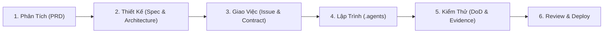

# Cẩm Nang Hướng Dẫn Sử Dụng `project-template`

Tài liệu hướng dẫn nhanh, đầy đủ và đúng trọng tâm dành cho **Tech Lead, Lập trình viên và AI Agent** khi khởi tạo và vận hành một dự án phần mềm mới từ template này.

---

## 1. Tổng Quan Về Template

Template này là bộ khung làm việc chuẩn mực cho quy trình phát triển phần mềm có AI hỗ trợ (**AI-Native SDLC**), tương thích tối ưu với **Google Antigravity + Gemini** và sẵn sàng mở rộng sang **Claude**.

### 4 Quy Tắc Cốt Lõi Bắt Buộc Nhớ:
1. **Không tự tiện quyết định thay người dùng**: Mọi thông số về ngôn ngữ, framework, kiến trúc và màu sắc UI phải do người dùng chốt trước tại `docs/techs/` và `docs/ui-ux/`.
2. **Không tự ý commit hay push**: AI Agent tuyệt đối không tự chạy `git commit` hoặc `git push`, chỉ cung cấp lệnh và tên commit chuẩn (Conventional Commits) để người dùng duyệt.
3. **Quy chuẩn chú thích trong mã nguồn**: Toàn bộ comment trong code phải viết bằng tiếng Việt, tuyệt đối không dùng dấu ngoặc đơn `()` và không dùng icon.
4. **Nghiệm thu dựa trên bằng chứng (Evidence-Based Completion)**: Không tự kết luận PASS nếu chưa chạy lệnh test/lint thực tế.

---

## 2. Quy Trình Khởi Tạo Dự Án Mới (Day 0)

### Bước 1: Khởi Tạo Repository Mới
Sử dụng kịch bản tự động hóa trong thư mục `scripts/` để tạo repo GitHub mới và đổi remote:

- **Trên Windows (PowerShell)**:
  ```powershell
  Set-ExecutionPolicy -Scope Process -ExecutionPolicy Bypass
  .\scripts\init-repo.ps1 -RepoName "ten-du-an-moi" -Visibility "private"
  ```
- **Trên Linux / macOS (Bash)**:
  ```bash
  chmod +x ./scripts/init-repo.sh
  ./scripts/init-repo.sh -r "ten-du-an-moi" -v "private"
  ```

### Bước 2: Chốt Ngôn Ngữ & Công Nghệ
Mở file [docs/techs/decision-checklist.md](docs/techs/decision-checklist.md) và tích chọn công nghệ bạn muốn dùng:
- Ngôn ngữ & Framework (Node.js/TypeScript, Python, Go, C# .NET...)
- Cơ sở dữ liệu (PostgreSQL, MySQL, MongoDB...) & Cache (Redis)
- Khai báo biến môi trường: Sao chép `.env.example` thành `.env` và điền khóa bí mật.

### Bước 3: Định Hình Bản Sắc UI/UX
Nếu dự án có giao diện người dùng, mở file [docs/ui-ux/DESIGN.md](docs/ui-ux/DESIGN.md) và [docs/ui-ux/design-tokens-template.md](docs/ui-ux/design-tokens-template.md) để thiết lập:
- Phong cách thẩm mỹ (Brand Persona) và cặp font chữ.
- Bảng màu chủ đạo Light/Dark Mode (loại bỏ màu gradient tím xanh AI rập khuôn).

---

## 3. Quy Trình Vận Hành Phát Triển (6 Bước SDLC)



### Bước 1: Phân Tích Yêu Cầu (Analysis)
- Soạn thảo tài liệu yêu cầu sản phẩm tại [docs/requirements/prd-template.md](docs/requirements/prd-template.md).
- Chuyển hóa thành các User Stories có tiêu chí nghiệm thu rõ ràng tại [docs/requirements/user-stories-template.md](docs/requirements/user-stories-template.md).

### Bước 2: Thiết Kế Kỹ Thuật (Design)
- **Kiến trúc hệ thống**: Lập tài liệu tại [docs/architecture/system-architecture.md](docs/architecture/system-architecture.md).
- **Lược đồ CSDL**: Viết thiết kế bảng tại [docs/database/database-design.md](docs/database/database-design.md) và SQL schema mẫu tại [docs/database/schema-template.sql](docs/database/schema-template.sql).
- **Đặc tả API**: Khai báo endpoint theo chuẩn OpenAPI 3.1 tại [docs/api-spec/openapi-template.yaml](docs/api-spec/openapi-template.yaml).

### Bước 3: Giao Việc & Lập Kế Hoạch (Task Planning)
- **Trưởng nhóm giao việc qua GitHub Issues**: Sử dụng các form mẫu chuẩn hóa tại tab **Issues** -> **New Issue**:
  - `🚀 Giao việc tính năng`: Giao User Story cho thành viên/AI kèm phạm vi và tiêu chí nghiệm thu.
  - `🐛 Giao việc sửa lỗi`: Giao lỗi cần fix kèm log, stacktrace và yêu cầu test hồi quy.
  - `⚙️ Nhiệm vụ kỹ thuật`: Giao việc cấu hình CI/CD, Docker, refactor hoặc migration CSDL.
  - `📐 Nghiên cứu kỹ thuật`: Giao tác vụ Spike nghiên cứu công nghệ mới kèm thời hạn timebox.

- **Cơ chế AI đọc Issue và biến Issue thành Implementation Plan**:
  - **Cách AI đọc Issue**: Khi bạn tạo Issue (ví dụ: `Issue #12`), bạn chỉ cần nhắn:
    > *"Hãy đọc Issue #12 và lập kế hoạch thực hiện"*
    AI Agent sẽ tự động chạy lệnh `gh issue view 12` thông qua GitHub CLI để trích xuất toàn bộ yêu cầu mà bạn đã điền.
  - **Tại sao Issue được AI xem là một Bản Kế Hoạch hoàn hảo?**
    1. *Khóa ngữ cảnh (Context Locking)*: AI chỉ đọc đúng các file đặc tả được liệt kê tại mục `References`.
    2. *Khóa phạm vi (Scope & Boundaries)*: Ngăn chặn triệt để tình trạng AI tự ý sửa các file ngoài thẩm quyền.
    3. *Danh mục thực thi (Acceptance Criteria)*: AI sử dụng các tiêu chí nghiệm thu làm checklist code từng bước.
    4. *Kế hoạch kiểm chứng (Verification Commands)*: AI lấy các lệnh test bạn yêu cầu để tự chạy thực tế trong terminal.
- **Lập khế ước tác vụ (Task Contract)**: Với các task phức tạp cần chia nhỏ, điền thêm vào [docs/task/task-contract-template.md](docs/task/task-contract-template.md) để bàn giao giữa các Subagent.

### Bước 4: Lập Trình Với AI Subagents (Coding)
Tận dụng 6 tác tử chuyên môn hóa tại thư mục [.agents/agents/](.agents/agents/):
- **`architect`**: Hỗ trợ thiết kế kiến trúc, phân rã module và API contracts.
- **`developer`**: Viết mã nguồn nghiệp vụ theo đúng Clean Architecture và quy chuẩn coding.
- **`ui-ux-designer`**: Thiết kế giao diện độc bản theo chuẩn Impeccable, hỗ trợ các lệnh `/impeccable craft`, `audit`, `polish`.
- **`qa-tester`**: Viết test tự động (Unit, Integration) bám sát Acceptance Criteria.
- **`devops`**: Cấu hình Docker, docker-compose.yml và pipeline GitHub Actions.
- **`security-reviewer`**: Rà soát bảo mật độc lập trước khi mở PR.

*Mẹo: Luôn yêu cầu AI tra cứu cấu trúc mã qua `.codegraph` trước khi chỉnh sửa file.*

### Bước 5: Kiểm Thử & Nghiệm Thu Dựa Trên Bằng Chứng (Testing)
Trước khi kết luận hoàn thành, bắt buộc phải chạy lệnh kiểm chứng thực tế trong terminal:
```bash
# 1. Kiểm tra linter và định dạng
npm run lint

# 2. Kiểm tra an toàn kiểu dữ liệu
npm run typecheck

# 3. Chạy toàn bộ bài kiểm thử
npm test
```
- Phân định rõ ràng trong báo cáo: `PASS` (vượt qua), `FAIL` (thất bại), `NOT RUN` (chưa chạy).
- Đáp ứng đầy đủ tiêu chuẩn hoàn thành tại [docs/standards/definition-of-done.md](docs/standards/definition-of-done.md).

### Bước 6: Mở Pull Request & Triển Khai (Review & Deploy)
- Mở PR trên GitHub theo biểu mẫu [.github/pull_request_template.md](.github/pull_request_template.md) (gắn kèm dòng `Closes #<số_issue>` để GitHub tự động đóng thẻ công việc khi hoàn thành).
- Pipeline CI tại [.github/workflows/ci.yml](.github/workflows/ci.yml) sẽ tự động chạy quét bảo mật Gitleaks và kiểm thử.
- Gắn link demo Vercel hoặc Render vào widget **Deployments** (xem hướng dẫn tại [docs/architecture/deployments-and-demo-links.md](docs/architecture/deployments-and-demo-links.md)) để phục vụ việc phỏng vấn hoặc nghiệm thu sản phẩm.

---

## 4. Bảng Tra Cứu Nhanh Thư Mục Dự Án

| Thư mục / File | Mục đích sử dụng |
| :--- | :--- |
| [`.agents/`](.agents/) | Chứa các quy tắc cốt lõi (`rules/`) và 6 hồ sơ chuyên môn của AI Subagents (`agents/`). |
| [`.codegraph/`](.codegraph/) | Chỉ mục đồ thị quan hệ mã nguồn giúp AI tra cứu cấu trúc chính xác. |
| [`.github/`](.github/) | Issue templates giao việc, Pull Request template và CI/CD workflows. |
| [`docs/product/`](docs/product/) | Tầm nhìn sản phẩm, MVP scope và lộ trình phát triển. |
| [`docs/requirements/`](docs/requirements/) | PRD và danh mục User Stories. |
| [`docs/techs/`](docs/techs/) | Khảo sát và ma trận chốt công nghệ do người dùng quyết định. |
| [`docs/architecture/`](docs/architecture/) | Tài liệu kiến trúc, ma trận phân quyền RBAC và hướng dẫn Deployments demo. |
| [`docs/database/`](docs/database/) | Thiết kế cơ sở dữ liệu, từ điển dữ liệu và migration template. |
| [`docs/api-spec/`](docs/api-spec/) | Đặc tả API chuẩn OpenAPI 3.1. |
| [`docs/ui-ux/`](docs/ui-ux/) | Bản sắc thiết kế UI/UX độc bản theo chuẩn Impeccable (`DESIGN.md`) và Design Tokens. |
| [`docs/task/`](docs/task/) | Khế ước tác vụ (`task-contract-template.md`), WBS và Sprint Backlog. |
| [`docs/standards/`](docs/standards/) | Tiêu chuẩn coding, checklist bảo mật OWASP, QA Strategy, DoD và quy chuẩn commit. |
| [`docs/dev-logs/`](docs/dev-logs/) | Nhật ký phát triển hàng ngày và hồ sơ quyết định kiến trúc (`adr/`). |
| [`scripts/`](scripts/) | Kịch bản tự động hóa khởi tạo repo mới trên GitHub. |
| [`AGENTS.md`](AGENTS.md) | "Hiến pháp" vận hành bắt buộc dành cho mọi AI Agent. |
