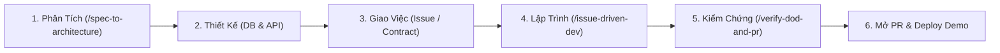

# Cẩm Nang Hướng Dẫn Sử Dụng `project-template`

Tài liệu hướng dẫn nhanh, đầy đủ và đúng trọng tâm dành cho **Tech Lead, Lập trình viên và AI Agent** khi khởi tạo và vận hành dự án phần mềm mới (cá nhân hoặc đồ án nhóm) trên nền tảng **Google Antigravity + Gemini** (sẵn sàng mở rộng sang **Claude**).

---

## 1. Tổng Quan & 4 Quy Tắc Cốt Lõi

1. **Không tự tiện quyết định thay người dùng**: Ngôn ngữ, framework, kiến trúc và màu sắc UI phải do người dùng chốt tại [docs/techs/decision-checklist.md](docs/techs/decision-checklist.md) và [docs/ui-ux/DESIGN.md](docs/ui-ux/DESIGN.md).
2. **Không tự ý commit hay push**: AI Agent tuyệt đối không tự chạy `git commit` hoặc `git push`, chỉ gợi ý câu lệnh và tên commit chuẩn Conventional Commits để người dùng duyệt.
3. **Quy chuẩn chú thích trong mã nguồn**: Toàn bộ comment trong code phải viết bằng tiếng Việt, tuyệt đối không dùng dấu ngoặc đơn `()` và không dùng icon/emoji.
4. **Nghiệm thu dựa trên bằng chứng (Evidence-Based Completion)**: Không tự kết luận `PASS` nếu chưa chạy lệnh build/lint/test thực tế; bước chưa chạy phải ghi rõ `NOT RUN`.

---

## 2. Tinh Gọn Tài Liệu Theo Quy Mô Dự Án (Tailoring Guide)

Bạn **không cần điền toàn bộ thư mục `docs/` ngay từ đầu**. Hãy chọn cấp độ phù hợp để tránh ngợp tài liệu:

| Cấp độ dự án | Quy mô gợi ý | Tài liệu cốt lõi cần dùng | Phần có thể bỏ qua hoặc làm sau |
| :--- | :--- | :--- | :--- |
| **Cấp 1: Cá nhân / Hackathon** | 1 người, 1–2 tuần | `decision-checklist.md`, `prd-template.md`, `task-contract-template.md` + Mã nguồn & Test | Sơ đồ C4 chi tiết, RBAC Matrix, ADR, NFR nâng cao |
| **Cấp 2: Đồ án nhóm / MVP** | 3–5 người, 1–3 tháng | Toàn bộ Cấp 1 + `system-architecture.md`, `database-design.md`, `openapi-template.yaml`, `DESIGN.md`, GitHub Issues & DoD | Kiểm toán hiệu năng tải lớn, NFR cấp doanh nghiệp |
| **Cấp 3: Sản phẩm lớn / Enterprise** | Nhóm lớn, dài hạn | Kích hoạt đầy đủ 100% tài liệu kiến trúc, ADR, RBAC, Security Checklist, QA Strategy, Deployments | Không bỏ qua bước nào |

---

## 3. Khởi Tạo Dự Án Mới (Day 0)

### Bước 1: Tạo Repository Mới Bằng Script
- **Windows (PowerShell)**:
  ```powershell
  Set-ExecutionPolicy -Scope Process -ExecutionPolicy Bypass
  .\scripts\init-repo.ps1 -RepoName "ten-du-an-moi" -Visibility "private"
  ```
- **Linux / macOS (Bash)**:
  ```bash
  chmod +x ./scripts/init-repo.sh
  ./scripts/init-repo.sh -r "ten-du-an-moi" -v "private"
  ```

### Bước 2: Chốt Công Nghệ Bằng Lệnh `/project-bootstrap`
Mở khung chat trong Antigravity và gõ trực tiếp lệnh:
```text
/project-bootstrap
```
*(Hoặc nhắn bằng ngôn ngữ tự nhiên: "Hãy khởi tạo cấu hình dự án mới giúp tôi")*.

AI sẽ khảo sát bạn chọn cấp độ dự án, Tech Stack, định hướng UI/UX, rồi đồng bộ vào `decision-checklist.md`, `DESIGN.md` và `.github/workflows/ci.yml`. Sau đó bạn chỉ cần sao chép `.env.example` thành `.env` để điền khóa bí mật cục bộ.

---

## 4. Hệ Thống Tự Động Hóa `.agents/` Trong Antigravity

Không cần copy-paste prompt thủ công — Antigravity tự động nhận diện **Rules**, **Agents** và **Skills** ngay trong kho mã nguồn:

### 4.1. Bộ 5 Skills Cốt Lõi & Lệnh Slash Commands (`.agents/skills/`)
Trong Antigravity (và tương thích khi mở rộng sang Claude Code), mỗi Skill tại `.agents/skills/<tên-skill>/SKILL.md` hỗ trợ **2 cơ chế kích hoạt**:
1. **Gọi tường minh bằng Slash Command `/<tên-skill>`** *(Khuyên dùng)*: Gõ dấu `/` trong ô chat để mở menu gợi ý và chỉ định đích danh quy trình cần chạy kèm yêu cầu.
2. **Kích hoạt tự động theo ngữ cảnh (Semantic Discovery)**: Antigravity chỉ nạp sẵn tên + mô tả ngắn để tiết kiệm token, và tự mở `SKILL.md` khi câu nhắn tự nhiên của bạn khớp nhiệm vụ.

| Lệnh gọi nhanh (Slash Command) | File Skill | Mục đích & Ví dụ sử dụng thực tế |
| :--- | :--- | :--- |
| `/project-bootstrap` | [`SKILL.md`](.agents/skills/project-bootstrap/SKILL.md) | Khảo sát quy mô & Tech Stack Day 0, đồng bộ cấu hình CI/CD & UI.<br>*VD:* `/project-bootstrap Khởi tạo đồ án nhóm quản lý bán hàng` |
| `/spec-to-architecture` | [`SKILL.md`](.agents/skills/spec-to-architecture/SKILL.md) | Viết PRD, User Stories Gherkin, thiết kế Kiến trúc, CSDL, OpenAPI & ADR.<br>*VD:* `/spec-to-architecture Phân tích và thiết kế phân hệ Đặt hàng` |
| `/issue-driven-dev` | [`SKILL.md`](.agents/skills/issue-driven-dev/SKILL.md) | Tạo GitHub Issues giao việc hoặc đọc `gh issue view <id>`, tra cứu CodeGraph và lập trình.<br>*VD:* `/issue-driven-dev Đọc và thực hiện Issue #12` |
| `/impeccable-ui-workflow` | [`SKILL.md`](.agents/skills/impeccable-ui-workflow/SKILL.md) | Dựng và kiểm toán UI độc bản chuẩn Impeccable, đạt WCAG 2.1 AA.<br>*VD:* `/impeccable-ui-workflow craft màn hình Dashboard quản trị` |
| `/verify-dod-and-pr` | [`SKILL.md`](.agents/skills/verify-dod-and-pr/SKILL.md) | Quét luật comment tiếng Việt, chạy lint/test thực tế và gợi ý commit / PR.<br>*VD:* `/verify-dod-and-pr Kiểm tra toàn bộ thay đổi cho Issue #12` |

### 4.2. Đội Ngũ 6 Custom Subagents (`.agents/agents/`)
Khi tác vụ lớn cần tách ngữ cảnh độc lập, Agent chính tự động ủy quyền qua `invoke_subagent` cho:
- **`architect`** ([architect.md](.agents/agents/architect.md)): Kiến trúc hệ thống, lược đồ CSDL, OpenAPI và ADR.
- **`developer`** ([developer.md](.agents/agents/developer.md)): Lập trình nghiệp vụ Backend/Frontend sạch, an toàn kiểu tĩnh.
- **`ui-ux-designer`** ([ui-ux-designer.md](.agents/agents/ui-ux-designer.md)): Thiết kế giao diện độc bản, chống AI tells, đủ 5 trạng thái UI.
- **`qa-tester`** ([qa-tester.md](.agents/agents/qa-tester.md)): Viết Unit/Integration Test bao phủ biên và kiểm thử hồi quy.
- **`devops`** ([devops.md](.agents/agents/devops.md)): Cấu hình Docker, `docker-compose.yml`, GitHub Actions và Deployments.
- **`security-reviewer`** ([security-reviewer.md](.agents/agents/security-reviewer.md)): Rà soát độc lập OWASP Top 10 và rò rỉ bí mật trên PR diff *(chế độ chỉ đọc + chạy lệnh kiểm tra)*.

---

## 5. Luồng Làm Việc 6 Bước Chuẩn SDLC



1. **Phân tích (Analysis)**: Gõ `/spec-to-architecture <mô tả bài toán>` để soạn [prd-template.md](docs/requirements/prd-template.md) và [user-stories-template.md](docs/requirements/user-stories-template.md).
2. **Thiết kế (Design)**: Tiếp tục với `/spec-to-architecture` để hoàn thiện [system-architecture.md](docs/architecture/system-architecture.md), [database-design.md](docs/database/database-design.md), [openapi-template.yaml](docs/api-spec/openapi-template.yaml); dùng `/impeccable-ui-workflow` để chốt [DESIGN.md](docs/ui-ux/DESIGN.md).
3. **Giao việc (Task Planning)**:
   - Trưởng nhóm tạo thẻ tại **GitHub Issues -> New Issue** với 4 biểu mẫu giao việc (`🚀 Giao việc tính năng`, `🐛 Giao việc sửa lỗi`, `⚙️ Nhiệm vụ kỹ thuật`, `📐 Nghiên cứu kỹ thuật`), hoặc gõ `/issue-driven-dev Tách PRD thành các GitHub Issues`, hoặc điền [task-contract-template.md](docs/task/task-contract-template.md).
   - Mỗi Issue đóng vai trò là **Implementation Plan** khóa chặt ngữ cảnh (`References`), phạm vi (`Scope & Boundaries`), tiêu chí nghiệm thu (`Acceptance Criteria`) và lệnh kiểm tra (`Verification Commands`).
4. **Lập trình (Coding)**: Gõ `/issue-driven-dev Đọc và thực hiện Issue #N` (kết hợp `/impeccable-ui-workflow` khi dựng giao diện). AI tự chạy `gh issue view N`, tra cứu `.codegraph` trước khi sửa file và viết kèm bài kiểm thử.
5. **Kiểm chứng & Nghiệm thu (Testing & DoD)**:
   - Gõ `/verify-dod-and-pr` (hoặc AI tự chuyển tiếp sau khi code xong): AI đối chiếu `git diff` đảm bảo comment tiếng Việt không có `()` và không có icon, chạy thực tế linter, typecheck, test suite và xuất bảng báo cáo `PASS` / `FAIL` / `NOT RUN` theo [definition-of-done.md](docs/standards/definition-of-done.md).
6. **Review & Triển khai (PR & Deploy)**:
   - Bạn kiểm tra diff, chạy lệnh `git commit` theo gợi ý của AI và mở PR theo [pull_request_template.md](.github/pull_request_template.md) kèm `Closes #<số_issue>` để tự động đóng Issue khi merge.
   - CI tại [ci.yml](.github/workflows/ci.yml) quét Gitleaks + chạy test; gắn link demo Vercel/Render lên GitHub **Deployments** theo [deployments-and-demo-links.md](docs/architecture/deployments-and-demo-links.md).

---

## 6. Bảng Tra Cứu Nhanh Cấu Trúc Kho Mã Nguồn

| Thư mục / Tệp | Mục đích sử dụng |
| :--- | :--- |
| [`.agents/rules/`](.agents/rules/) | Luật hành vi và chống ảo giác luôn bật (`always_on`). |
| [`.agents/agents/`](.agents/agents/) | 6 hồ sơ Custom Subagents chuyên trách cho Antigravity. |
| [`.agents/skills/`](.agents/skills/) | 5 quy trình thực thi cốt lõi hỗ trợ gọi qua `/<tên-skill>`. |
| [`.codegraph/`](.codegraph/) | Cấu hình và hướng dẫn tra cứu đồ thị mã nguồn CodeGraph. |
| [`.github/`](.github/) | 4 biểu mẫu Issue giao việc, PR template, workflow CI & Deployments. |
| [`docs/product/`](docs/product/) & [`docs/requirements/`](docs/requirements/) | Tầm nhìn sản phẩm, lộ trình MVP, PRD và User Stories chuẩn Gherkin. |
| [`docs/techs/`](docs/techs/) | Bảng khảo sát và ma trận chốt quyết định công nghệ. |
| [`docs/architecture/`](docs/architecture/) & [`docs/diagrams/`](docs/diagrams/) | Kiến trúc hệ thống, RBAC, NFR, hướng dẫn link demo và sơ đồ Mermaid. |
| [`docs/database/`](docs/database/) & [`docs/api-spec/`](docs/api-spec/) | Thiết kế CSDL, SQL schema mẫu và đặc tả OpenAPI 3.1. |
| [`docs/ui-ux/`](docs/ui-ux/) | Đặc tả thương hiệu `DESIGN.md`, Design Tokens và chuẩn Impeccable UI/UX. |
| [`docs/task/`](docs/task/) | Khế ước tác vụ (`task-contract-template.md`), WBS và Sprint Backlog. |
| [`docs/standards/`](docs/standards/) | Coding Standards, Security Checklist, QA Strategy, DoD và Git Commit. |
| [`docs/ai-integration/`](docs/ai-integration/) | Kiến trúc tích hợp LLM trong sản phẩm (Model Router, Fallback, Prompt Injection Defense). |
| [`docs/dev-logs/`](docs/dev-logs/) | Nhật ký phát triển hàng ngày và hồ sơ quyết định kiến trúc (`adr/`). |
| [`scripts/`](scripts/) | Kịch bản khởi tạo repository GitHub mới (`init-repo.ps1`, `init-repo.sh`). |
| [`AGENTS.md`](AGENTS.md) | Hiến pháp vận hành trung tâm dành cho mọi AI Agent. |
