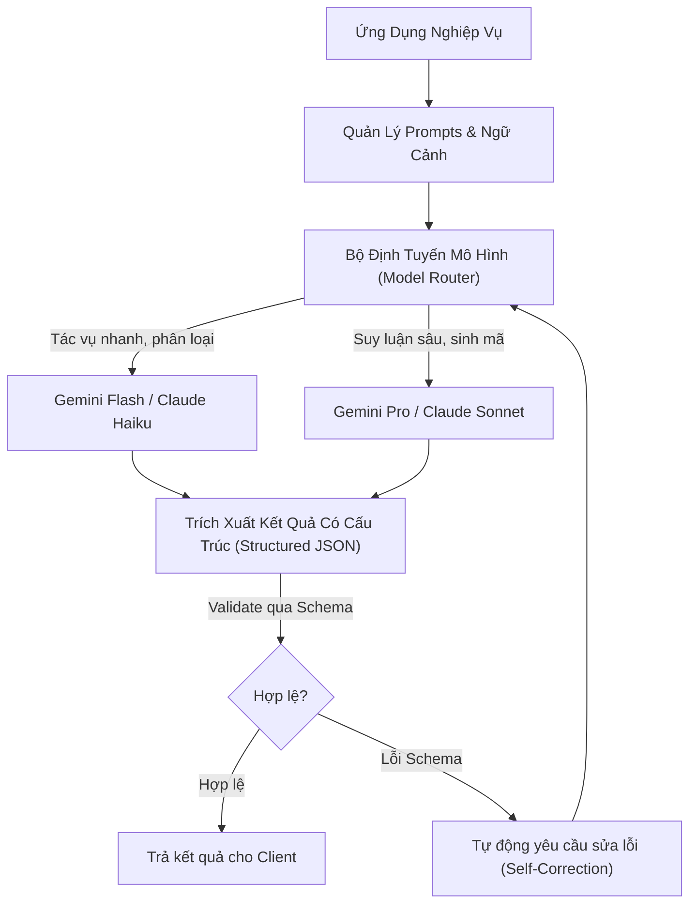

# Hướng Dẫn Tích Hợp AI & LLM Harness (AI Integration Guidelines)

*Tài liệu thiết kế kiến trúc tích hợp các mô hình ngôn ngữ lớn (LLMs), tối ưu hóa harness cho Antigravity, Gemini và Claude.*

---

## 1. Kiến Trúc Lớp AI Harness (AI Harness Layer)

---

## 2. Các Nguyên Tắc Thiết Kế Trọng Yếu
1. **Trích Xuất Dữ Liệu Có Cấu Trúc (Structured Outputs)**:
   - Luôn sử dụng `response_schema` (JSON Schema) hoặc Function Calling thay vì ép model sinh text tự do để tránh lỗi parse.
2. **Quản Lý Cửa Sổ Ngữ Cảnh (Context Window Management)**:
   - Tối ưu hóa token bằng cách tóm tắt (summarize) lịch sử hội thoại thay vì truyền toàn bộ lịch sử dài.
   - Với tài liệu lớn: Áp dụng RAG (Retrieval-Augmented Generation) hoặc tra cứu symbol qua `.codegraph`.
3. **Phòng Chống Tấn Công Tiêm Nhiễm Lệnh (Prompt Injection Defense)**:
   - Tách biệt rõ ràng giữa **System Instructions** (bất biến) và **User Inputs** (dữ liệu không tin cậy).
   - Tuyệt đối không cho phép input của người dùng ghi đè lên các quy định an toàn hệ thống.
4. **Xử Lý Streaming (Server-Sent Events / SSE)**:
   - Với các giao diện tương tác trực tiếp với người dùng, luôn bật streaming để giảm Time-to-First-Token (TTFT) xuống dưới 1 giây.
