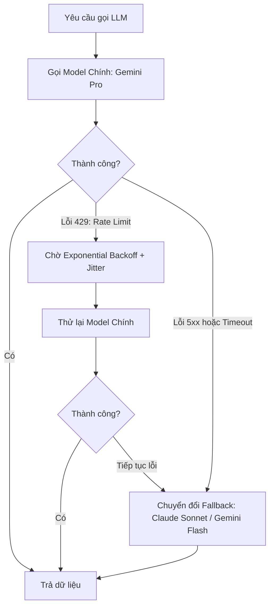

# Mô Hình Định Tuyến Mô Hình Thông Minh (Model Router Pattern)

Tài liệu này hướng dẫn chiến lược phân bổ tác vụ giữa các mô hình (Gemini và Claude) nhằm tối ưu hóa chi phí (Cost), độ trễ (Latency) và độ chính xác (Accuracy).

---

## 1. Bảng Phân Bổ Tác Vụ Theo Tầng Mô Hình

| Tầng Mô Hình | Đại Diện Tiêu Biểu | Tác Vụ Phù Hợp | Ưu Điểm |
| :--- | :--- | :--- | :--- |
| **Fast / Light Tier** | Gemini 1.5/2.0 Flash, Claude 3.5 Haiku | Phân loại intent, gán nhãn, tóm tắt văn bản ngắn, trích xuất thực thể, sửa lỗi chính tả | Độ trễ siêu thấp (<500ms), chi phí cực rẻ |
| **Heavy / Reasoning Tier**| Gemini 1.5/2.5 Pro, Claude 3.5/3.7 Sonnet | Phân tích kiến trúc phức tạp, sinh mã nguồn, rà soát bảo mật, giải toán logic sâu | Khả năng suy luận đa tầng, ít hallucination |

---

## 2. Chiến Lược Xử Lý Lỗi & Giới Hạn Tần Suất (Fallback & Rate Limiting)

### Quy tắc triển khai trong code:
1. **Exponential Backoff**: Khi gặp HTTP 429 (Too Many Requests), chờ theo công thức $T = 2^n \times 1000\text{ms} + \text{jitter}$ (với $n$ là số lần retry, tối đa 3 lần).
2. **Circuit Breaker**: Nếu tỷ lệ lỗi của một Provider vượt quá 50% trong 1 phút, ngắt kết nối tạm thời trong 30 giây và tự động chuyển toàn bộ traffic sang Provider dự phòng (vd: từ Gemini sang Claude hoặc ngược lại).
