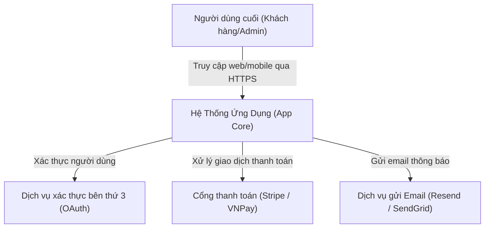
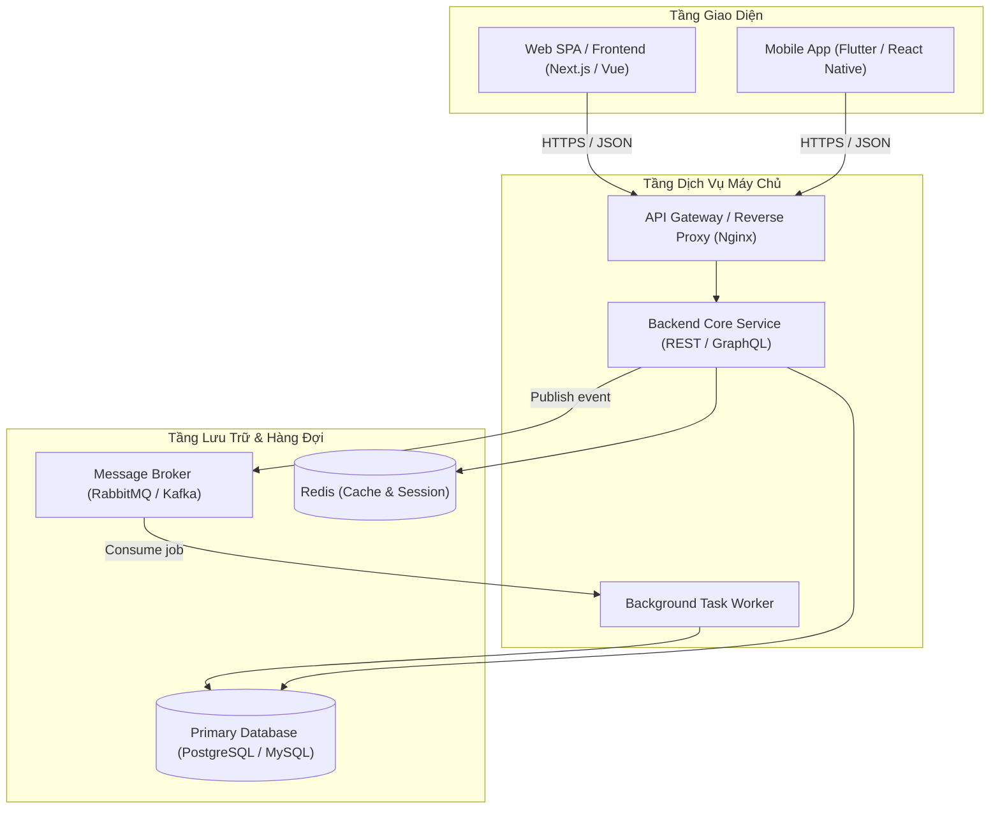
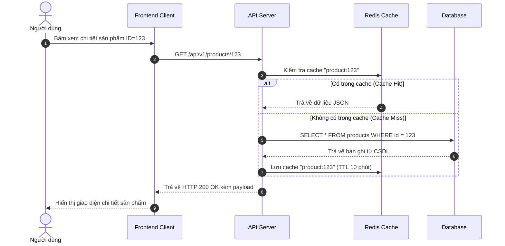
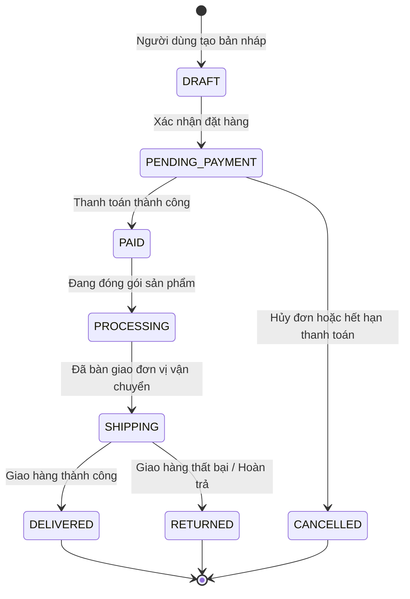
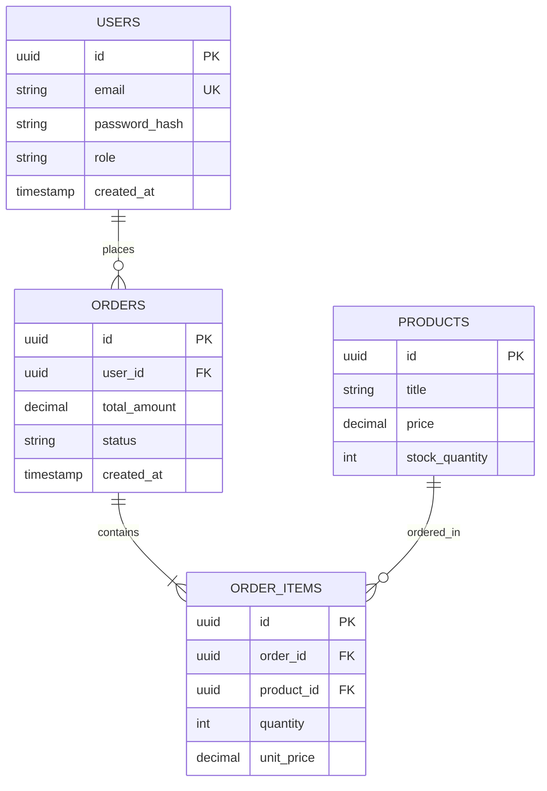

# Thư Viện Mẫu Sơ Đồ Mermaid (Mermaid Diagram Templates)

Tài liệu này cung cấp các đoạn mã Mermaid chuẩn để các Sub-Agents và kỹ sư sử dụng khi vẽ sơ đồ kỹ thuật.

---

## 1. Sơ Đồ Ngữ Cảnh Hệ Thống (C4 Model - System Context)

---

## 2. Sơ Đồ Phân Rã Thành Phần (C4 Model - Container Diagram)

---

## 3. Sơ Đồ Tuần Tự (Sequence Diagram - Luồng Nghiệp Vụ)

---

## 4. Sơ Đồ Trạng Thái (State Diagram - Vòng Đời Đơn Hàng / Thực Thể)

---

## 5. Sơ Đồ Thực Thể Quan Hệ CSDL (Entity-Relationship Diagram - ERD)

