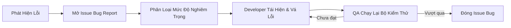

# Chiến Lược Kiểm Thử & Kế Hoạch Đảm Bảo Chất Lượng (QA Strategy & Test Plan)

Tài liệu này định hình chiến lược kiểm thử tự động toàn diện, phân bổ tài nguyên kiểm thử và cung cấp biểu mẫu quản trị kịch bản kiểm thử cho dự án.

---

## 1. Mô Hình Kim Tự Tháp Kiểm Thử (Testing Pyramid)

```text
       / \
      / E2E \       10% - Kiểm thử luồng người dùng đầu-cuối (Playwright, Cypress)
     /───────\
    /  Tích   \     20% - Kiểm thử tích hợp API, Database, Cache (Supertest, Testcontainers)
   /   Hợp     \
  /─────────────\
 /   Đơn Vị      \  70% - Kiểm thử đơn vị cô lập logic nghiệp vụ (Jest, Vitest, Pytest, Go test)
/─────────────────\
```

### Nguyên tắc phân bổ:
- **Unit Tests (Kiểm thử đơn vị - 70%)**: Tập trung vào Domain Entities, Value Objects, Use Cases, Helpers, Validators. Chạy cực nhanh dưới 100ms, không phụ thuộc mạng hay database thật.
- **Integration Tests (Kiểm thử tích hợp - 20%)**: Kiểm tra sự phối hợp giữa API endpoints, Database Repositories, Caching Layer. Đảm bảo câu lệnh SQL và migration hoạt động chính xác.
- **End-to-End Tests (Kiểm thử đầu-cuối - 10%)**: Kiểm tra các luồng hành trình người dùng quan trọng nhất (Critical User Journeys: Đăng ký -> Đăng nhập -> Mua hàng -> Thanh toán).

---

## 2. Tiêu Chuẩn Bao Phủ Mã Nguồn (Coverage Thresholds)
- **Toàn bộ dự án**: Tối thiểu `80%` code coverage.
- **Tầng Core Domain / Business Logic**: Bắt buộc đạt tối thiểu `90%` code coverage.
- **Tầng Controllers / Presenters**: Đạt tối thiểu `70%` code coverage.

---

## 3. Mẫu Bảng Kịch Bản Kiểm Thử (Test Case Matrix)

| Mã Test | Tên Kịch Bản | Module | Ưu Tiên | Tiền Điều Kiện | Các Bước Thực Hiện | Dữ Liệu Thử Nghiệm | Kết Quả Kỳ Vọng | Trạng Thái |
| :--- | :--- | :--- | :--- | :--- | :--- | :--- | :--- | :--- |
| `TC-AUTH-001` | Đăng nhập thành công với email hợp lệ | Auth | P0 | Tài khoản đã active trong CSDL | 1. Gửi POST /auth/login<br>2. Kiểm tra status<br>3. Kiểm tra payload | Email: `user@example.com`<br>Pass: `ValidPass123!` | Trả về HTTP 200, JWT token và thông tin user | ✅ Pass |
| `TC-AUTH-002` | Khóa tài khoản khi nhập sai pass 5 lần | Auth | P0 | Tài khoản tồn tại | 1. Gửi POST /auth/login sai pass 5 lần liên tiếp | Email: `user@example.com`<br>Pass: `WrongPass` | Lần thứ 5 trả về HTTP 429 hoặc thông báo tài khoản bị khóa 15 phút | ✅ Pass |
| `TC-ITEM-001` | Tạo mục dữ liệu mới có giá hợp lệ | Items | P1 | Người dùng đã đăng nhập | 1. Gửi POST /items kèm header Authorization | Title: `Bàn làm việc`<br>Price: `1500000` | Trả về HTTP 201 kèm id bản ghi vừa tạo | ⚪ Chưa test |
| `TC-ITEM-002` | Báo lỗi khi giá trị tiền âm | Items | P1 | Người dùng đã đăng nhập | 1. Gửi POST /items với giá âm | Title: `Ghế xoay`<br>Price: `-50000` | Trả về HTTP 422 lỗi Validation | ⚪ Chưa test |

---

## 4. Vòng Đời Xử Lý Lỗi Kiểm Thử (Defect Lifecycle)



---

## 5. Quy Chuẩn Viết Mã Kiểm Thử Dành Cho Kỹ Sư & AI Agent
- Mọi ghi chú hoặc chú thích trong file test phải viết hoàn toàn bằng tiếng Việt, tuyệt đối không dùng dấu ngoặc đơn và không dùng biểu tượng cảm xúc.
- Tên hàm test phải diễn đạt rõ ràng theo cấu trúc: `should_<kết_quả_mong_đợi>_when_<hành_động_hoặc_điều_kiện>`.
- Mỗi ca kiểm thử phải tuân theo cấu trúc AAA: **Arrange (Chuẩn bị) -> Act (Hành động) -> Assert (Khẳng định)**.
