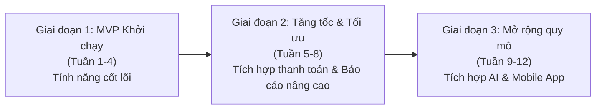

# 02 - Lộ Trình Phát Triển & Phạm Vi MVP (Roadmap & MVP Scope)

*Tài liệu định hình phạm vi sản phẩm khả thi tối thiểu (MVP) và lộ trình phát hành các phiên bản tiếp theo.*

---

## 1. Định Nghĩa Phạm Vi MVP (Phase 1 - MVP Scope)

### Những gì PHẢI CÓ (Must Have - In Scope)
- [ ] Tính năng 1: [Ví dụ: Đăng ký / Đăng nhập qua Email & Google OAuth]
- [ ] Tính năng 2: [Ví dụ: Tạo, xem, cập nhật danh mục sản phẩm cốt lõi]
- [ ] Tính năng 3: [Ví dụ: Luồng đặt hàng và thanh toán cơ bản]
- [ ] Báo cáo tóm tắt doanh số đơn giản

### Những gì KHÔNG LÀM trong MVP (Out of Scope)
- [ ] Tính năng khuyến mãi đa tầng phức tạp (Dời sang Phase 2)
- [ ] Tích hợp đơn vị vận chuyển quốc tế (Dời sang Phase 3)
- [ ] Ứng dụng di động Native (Chỉ tập trung Web Responsive trước)

---

## 2. Lộ Trình Phát Hành (Product Release Roadmap)

### Chi tiết các giai đoạn:
1. **Phase 1 (MVP)**:
   - Thời gian dự kiến: `[Điền mốc thời gian]`
   - Mục tiêu: Kiểm chứng nhu cầu thị trường (Product-Market Fit), thu thập phản hồi từ 50-100 người dùng đầu tiên.
2. **Phase 2 (Growth & Monetization)**:
   - Mục tiêu: Bổ sung tính năng trả phí, cải thiện hiệu năng và luồng chuyển đổi.
3. **Phase 3 (Scale & Automation)**:
   - Mục tiêu: Mở rộng API cho bên thứ 3, tích hợp AI Assistant chuyên sâu.
