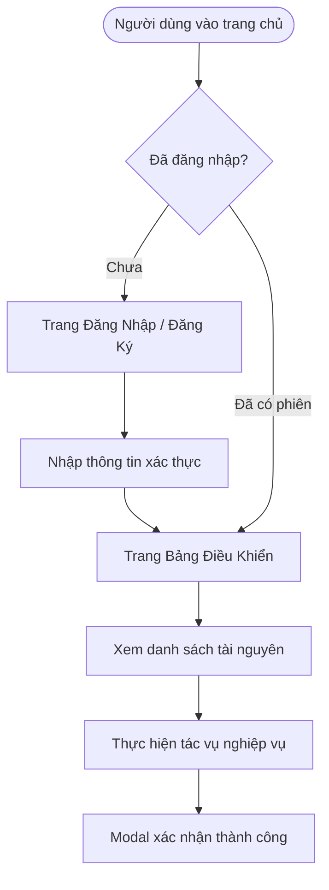

# Hành Trình Người Dùng & Khung Giao Diện (User Journey & Wireframes)

---

## 1. Bản Đồ Hành Trình Người Dùng (User Journey Flow)

---

## 2. Ma Trận Trạng Thái Giao Diện (UI State Matrix)
Mọi component giao diện khi thiết kế và lập trình bắt buộc phải xử lý đủ 5 trạng thái:
1. **Initial / Default State**: Trạng thái hiển thị thông thường, sẵn sàng tương tác.
2. **Loading / Skeleton State**: Trạng thái đang tải dữ liệu (sử dụng Skeleton loader hoặc spinner).
3. **Empty State**: Khi danh sách không có dữ liệu (có hình minh họa + nút CTA kêu gọi hành động).
4. **Error State**: Khi kết nối mạng lỗi hoặc API trả về 5xx (có nút 'Thử lại' - Retry).
5. **Success State**: Phản hồi tức thì khi thao tác thành công (Toast notification hoặc banner).

---

## 3. Tiêu Chuẩn Tiếp Cận Người Dùng (Accessibility - WCAG 2.1 AA)
- Độ tương phản màu sắc giữa văn bản và màu nền đạt tối thiểu `4.5:1` cho chữ thường và `3:1` cho chữ lớn.
- Hỗ trợ đầy đủ điều hướng bằng bàn phím (Tab, Enter, Escape).
- Mọi hình ảnh và biểu tượng (Icons) mang ý nghĩa đều phải có thuộc tính `alt` hoặc `aria-label`.
