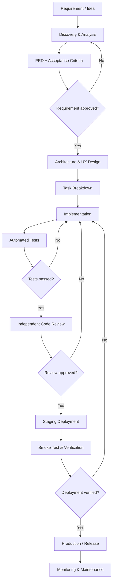

# Đánh giá và đề xuất cải thiện `project-template`

**Repository:** https://github.com/phuctran1501/project-template  
**Mục tiêu đánh giá:** Xem xét mức độ hoàn thiện của template dành cho AI-assisted / AI-native software development, đặc biệt trong workflow Antigravity + Gemini, đồng thời xác định thiếu sót và thứ tự ưu tiên cải thiện.

> **Lưu ý về phạm vi:** Đây là bản tổng hợp các nhận xét và đề xuất đã nêu trong cuộc trao đổi. Điểm số là đánh giá định tính, không phải kết quả benchmark hay kiểm thử toàn bộ repository trên máy thực tế. Các đường dẫn, tính năng của công cụ bên thứ ba và định dạng cấu hình cần được đối chiếu lại với tài liệu chính thức tại thời điểm triển khai.

---

## 1. Kết luận tổng quan

`project-template` có định hướng tốt cho việc xây dựng một **AI-Native Software Development Framework**. Repository đã có nền tảng về quy tắc cho AI, phân chia vai trò, tài liệu kỹ thuật, CodeGraph, Impeccable, scripts và CI/CD.

Tuy nhiên, template hiện **mạnh về tổ chức tài liệu và quy định hành vi AI hơn khả năng thực thi, kiểm chứng và tự động hóa các quy định đó**. Nói cách khác, đã có bộ khung quản lý AI Developer, nhưng chưa hoàn thiện thành một Engineering System có các quality gate đủ tin cậy.

### Đánh giá định tính

| Tiêu chí | Điểm | Nhận xét |
|---|---:|---|
| Tư duy tổ chức và kiến trúc | 8/10 | Có cấu trúc và định hướng rõ |
| AI Agent Instructions | 7/10 | Có nguyên tắc, vai trò và quy trình nhưng còn cứng |
| Agent Runtime Integration | 4/10 | Cần rà soát cấu trúc và metadata để agent được nhận diện đúng |
| Testing & CI/CD | 3/10 | Chưa chứng minh được build/test thực tế |
| Security & Automation | 5/10 | Có checklist nhưng thiếu enforcement và một số cấu hình cần sửa |
| Developer Experience | 6/10 | Có scripts và docs, cần tăng độ an toàn và tính nhất quán |

**Điểm tổng thể tham khảo: 6/10.** Đây là đánh giá chủ quan dựa trên cấu trúc và nội dung đã kiểm tra, không phải điểm số đo lường tự động.

---

## 2. Những điểm đang làm tốt

### 2.1. Có cấu trúc AI Agent Harness

Repository đã phân tách các thành phần có trách nhiệm riêng:

- `.agent/rules/`: Quy tắc vận hành và coding conventions.
- `.agent/subagents/`: Vai trò chuyên biệt như Architect, Developer, QA, DevOps, Security Reviewer và UI/UX Designer.
- `.codegraph/`: Hướng dẫn tra cứu cấu trúc và quan hệ trong codebase.
- `docs/`: Tài liệu sản phẩm, kiến trúc, API, database và tiêu chuẩn.
- `scripts/`: Hỗ trợ khởi tạo và tự động hóa.

Đây là nền tảng tốt để tránh việc một agent tự đảm nhiệm toàn bộ quá trình mà không có kiểm tra độc lập.

### 2.2. Có bước xác nhận công nghệ và kiến trúc

Decision checklist giúp hạn chế việc AI tự ý lựa chọn stack hoặc tự đặt ra kiến trúc không phù hợp. Nên giữ cơ chế xác nhận các quyết định quan trọng trước khi triển khai.

### 2.3. Kết hợp CodeGraph và Impeccable

- **CodeGraph:** Hỗ trợ tìm hiểu symbol, dependency và call path trước khi sửa code.
- **Impeccable:** Bổ sung quy trình critique, audit và polish giao diện thay vì chỉ yêu cầu AI tạo UI đẹp.

Hai công cụ này phù hợp với mục tiêu phát triển phần mềm có AI hỗ trợ, nhưng cần được tích hợp vào workflow có thể kiểm chứng.

### 2.4. Có phân tách đặc tả và triển khai

Các tài liệu như PRD, System Architecture, SQL Schema, OpenAPI Specification, Design Tokens và Definition of Done giúp tạo nguồn thông tin dự án rõ ràng hơn so với việc chỉ dựa vào lịch sử chat.

---

## 3. Các thiếu sót và đề xuất cải thiện

## P0 — Cần ưu tiên xử lý trước

### 3.1. Chuẩn hóa cấu trúc Antigravity Custom Agents

Cấu trúc hiện tại được nhận xét là:

```text
.agent/
└── subagents/
    ├── architect.md
    ├── developer.md
    ├── qa-tester.md
    ├── devops.md
    ├── security-reviewer.md
    └── ui-ux-designer.md
```

Điểm cần kiểm tra là cấu trúc này có được Antigravity tự động discover như custom agents hay không. Theo định dạng được đối chiếu trong lần đánh giá, nên chuyển sang cấu trúc custom agents phù hợp với Antigravity và khai báo metadata bằng YAML Frontmatter.

Cấu trúc mục tiêu tham khảo:

```text
.agents/
└── agents/
    ├── architect.md
    ├── developer.md
    ├── qa-tester.md
    ├── devops.md
    ├── security-reviewer.md
    ├── code-reviewer.md
    └── ui-ux-designer.md
```

Ví dụ Frontmatter minh họa:

```yaml
---
name: architect
description: >
  Analyze business requirements and design system architecture,
  database structures, and API contracts.
tools:
  - view_file
  - grep_search
  - run_command
subagent: true
mainAgent: false
model: pro
commandExecutionPolicy: sandbox
---
```

**Lưu ý:** Các trường metadata và danh sách tool trong ví dụ phải được đối chiếu với schema và tool thực tế mà phiên bản Antigravity đang sử dụng hỗ trợ. Không sao chép nguyên mẫu nếu tên tool hoặc field không hợp lệ.

### 3.2. Sửa CI để thực sự build, test và kiểm tra chất lượng

Workflow CI hiện được nhận xét là chủ yếu checkout source và chạy lệnh `echo`; các bước Node.js, Python, Go và .NET đang bị comment. Vì vậy, CI xanh không chứng minh source code đã build hoặc test thành công.

Đề xuất tổ chức:

```text
.github/
└── workflows/
    ├── ci.yml
    ├── security.yml
    └── deploy.yml
```

- `ci.yml`: Chạy formatter/linter, build và test theo stack thực tế đã chọn.
- `security.yml`: Chạy secret scanning, dependency audit và các security checks phù hợp.
- `deploy.yml`: Chỉ triển khai khi project đã cấu hình môi trường và điều kiện release.

Nguyên tắc:

1. Không tạo một CI universal bằng cách comment hàng loạt platform.
2. Chỉ chạy job tương ứng với tech stack của dự án.
3. Quality gate bắt buộc phải làm pipeline thất bại khi không đạt.
4. Không dùng `continue-on-error: true` cho các kiểm tra bảo mật bắt buộc nếu mục tiêu là chặn lỗi.

### 3.3. Rà soát cấu hình Gitleaks

Cấu hình hiện tại được nhận xét có allowlist rộng cho toàn bộ `docs/` và file compose. Điều này có thể bỏ lọt secret nếu credential bị commit nhầm vào các vị trí đó.

Đề xuất:

- Không bỏ qua toàn bộ thư mục tài liệu hoặc file cấu hình hạ tầng.
- Chỉ allowlist file, dòng hoặc placeholder cụ thể sau khi xác minh.
- Duy trì quét secret trên toàn repository theo mặc định.
- Đảm bảo kết quả phát hiện secret làm CI fail hoặc yêu cầu xử lý rõ ràng.

### 3.4. Hoàn thiện `.gitignore` cho biến môi trường

Các pattern hiện tại có thể chưa bao phủ đầy đủ `.env.development`, `.env.production`, `.env.staging`, `.env.test` và các biến thể tương tự.

Có thể sử dụng:

```gitignore
# Environment variables
.env
.env.*
!.env.example
!.env.*.example
```

Cần kiểm tra lại các file mẫu cần commit để bảo đảm không vô tình loại bỏ chúng khỏi Git.

---

## P1 — Quan trọng, nên xử lý trong đợt hoàn thiện tiếp theo

### 3.5. Chuyển từ Rules-first sang Rules + Agents + Skills

Template hiện có nhiều hướng dẫn về việc AI phải làm gì, nhưng chưa có đủ workflow cụ thể mô tả cách thực hiện một nhiệm vụ từ đầu đến cuối.

Cần phân biệt rõ:

- **Rule:** Quy định bắt buộc và có tính ổn định, ví dụ không commit khi chưa được cho phép.
- **Agent:** Vai trò chịu trách nhiệm, ví dụ Security Reviewer.
- **Skill:** Quy trình thực hiện một công việc, ví dụ cách tiến hành Security Audit.

Các skill nên bổ sung:

| Skill | Trách nhiệm |
|---|---|
| `project-discovery` | Khám phá yêu cầu, bối cảnh và vấn đề cần giải quyết |
| `prd-creation` | Viết PRD, user stories và acceptance criteria |
| `architecture-design` | Thiết kế kiến trúc, ADR, database và API contracts |
| `feature-planning` | Phân rã task, dependency và implementation plan |
| `feature-development` | Triển khai feature theo task contract |
| `test-engineering` | Thiết kế, viết và chạy kiểm thử |
| `code-review` | Review diff, logic, maintainability và regression |
| `security-audit` | Phân tích rủi ro và kiểm tra bảo mật |
| `ui-implementation` | Triển khai UI dựa trên design system và DESIGN.md |
| `deployment` | Build, deploy, smoke test và xác minh triển khai |

Mỗi skill nên có `SKILL.md` mô tả mục đích, điều kiện sử dụng, đầu vào, quy trình, đầu ra, verification và fallback khi thiếu công cụ.

### 3.6. Hoàn thiện quy trình vận hành CodeGraph

Hướng dẫn CodeGraph hiện cần làm rõ hơn các nội dung:

- Cài đặt CLI và cấu hình MCP server.
- Kiểm tra CodeGraph đã sẵn sàng hay chưa.
- Index lần đầu và cập nhật index sau thay đổi.
- Kiểm tra index lỗi thời hoặc thất bại.
- Fallback khi CLI/MCP không khả dụng.
- Khi nào dùng CodeGraph, khi nào dùng grep hoặc đọc file trực tiếp.
- Cách xác minh thông tin tìm được bằng source code thực tế.

Cấu hình include cần tính đến các dạng monorepo phổ biến như `Backend/src/`, `Frontend/src/`, `apps/`, `services/`, `packages/` thay vì chỉ giả định `src/`, `lib/` hoặc `app/` ở root.

Không nên mặc định index mọi tài liệu nếu điều đó tạo nhiễu hoặc trùng lặp với hệ thống quản lý context khác.

Workflow tham khảo:

1. Kiểm tra trạng thái index.
2. Index hoặc cập nhật khi cần.
3. Explore symbol, dependency và call path liên quan.
4. Đọc source file thực tế trước khi thay đổi.
5. Sau khi sửa, kiểm tra lại các dependency hoặc call path bị ảnh hưởng.

### 3.7. Hoàn thiện tích hợp Impeccable

Cần có hướng dẫn cài đặt, khởi tạo và kiểm chứng Impeccable thay vì chỉ liệt kê một số command.

Đề xuất:

- Ghi rõ phiên bản/cách cài đặt được khuyến nghị.
- Có bước khởi tạo design context và tài liệu thiết kế.
- Cập nhật các command theo phiên bản Impeccable hiện tại; tránh dùng command đã deprecated như thể vẫn là workflow chính.
- Cân nhắc sử dụng design hooks hoặc detector để kiểm tra thay đổi UI tự động.
- Tích hợp UI audit vào review/CI khi khả thi.
- Với thay đổi giao diện quan trọng, yêu cầu browser-based review hoặc bằng chứng trực quan.

### 3.8. Chia Coding Standards theo ngôn ngữ

Một bộ quy chuẩn chung cho C#, TypeScript, Python, Go và Rust dễ dẫn đến các quy tắc không phù hợp với convention của từng ngôn ngữ.

Cấu trúc đề xuất:

```text
docs/standards/
├── universal-standards.md
├── security-standards.md
├── testing-standards.md
└── language/
    ├── csharp.md
    ├── typescript.md
    ├── python.md
    ├── golang.md
    └── rust.md
```

Một số điều chỉnh:

- C# thường dùng PascalCase cho method/property/type và camelCase cho local variable/parameter.
- TypeScript thường dùng camelCase cho function/variable và PascalCase cho class/component/type.
- Python thường dùng snake_case cho function/variable và PascalCase cho class.
- Go dùng convention riêng về exported/unexported identifiers.
- Rust thường dùng snake_case cho function/variable và PascalCase cho type.

Không nên biến các tiêu chí như “hàm tối đa 30 dòng” thành luật tuyệt đối. Có thể xem độ dài hàm là tín hiệu để review, không phải điều kiện máy móc.

Cũng nên tránh bắt buộc comment bằng một ngôn ngữ duy nhất hoặc cấm dấu câu không đem lại giá trị kỹ thuật. Formatter và linter nên enforce các quy tắc có thể kiểm chứng tự động.

### 3.9. Bổ sung chiều sâu cho PRD

PRD template nên có thêm các phần:

- User Personas.
- User Journey.
- User Stories.
- Acceptance Criteria, có thể dùng Gherkin.
- Out of Scope.
- Functional Dependencies.
- Non-functional Requirements.
- Business Constraints.
- Data Privacy Requirements.
- Assumptions và Risks.

Đảm bảo các nội dung mà system prompt yêu cầu AI tạo ra cũng có vị trí tương ứng trong tài liệu PRD để tránh thiếu nhất quán.

### 3.10. Bổ sung chiều sâu cho System Architecture

Ngoài các module và thành phần tổng quát, Architecture Template nên xem xét:

- Deployment Architecture.
- Component Boundaries.
- Data Flow.
- Integration Contracts.
- Failure Handling.
- Scalability Strategy.
- Observability.
- Architecture Trade-offs.
- Security Boundaries và Trust Boundaries.
- Architecture Decision Records (ADR).

Các module mẫu như Auth, Core Business, Notification hoặc AI/Analytics phải được đánh dấu là ví dụ tham khảo, không phải thành phần bắt buộc trong mọi dự án.

### 3.11. Mở rộng Security Checklist

Các nội dung nền tảng như SQL Injection, XSS, CSRF, IDOR, JWT và Rate Limiting nên được giữ lại, đồng thời bổ sung:

| Nhóm | Nội dung cần xem xét |
|---|---|
| Authentication | Refresh token rotation, revocation, password reset, MFA |
| Authorization | RBAC/ABAC, tenant isolation, privilege escalation |
| File Security | MIME validation, file signature, malware scanning, upload limits |
| API Security | SSRF, CORS, mass assignment, sensitive data exposure |
| Database | Least privilege, backup, encryption, migration safety |
| Infrastructure | Container scanning, dependency scanning, TLS configuration |
| Monitoring | Security audit log, anomaly detection, alerting |
| AI Security | Prompt injection, data leakage, output validation, abuse limits |

Với XSS, cần giải thích rõ output encoding theo ngữ cảnh render. Không nên mô tả sanitization đầu vào như giải pháp thay thế toàn diện cho output encoding.

### 3.12. Tách Docker Compose theo nhu cầu dự án

Nếu template hỗ trợ nhiều database và infrastructure nhưng compose mặc định luôn khởi chạy PostgreSQL, Redis, Mailpit thì chưa thật sự linh hoạt.

Cấu trúc tham khảo:

```text
docker/
├── compose.base.yml
├── compose.postgres.yml
├── compose.mysql.yml
├── compose.mongodb.yml
└── compose.observability.yml
```

Một số vấn đề cần rà soát:

- Không dùng credential mặc định yếu cho môi trường ngoài local.
- Redis cần authentication/network isolation phù hợp.
- Healthcheck không nên hardcode user nếu có thể cấu hình biến môi trường.
- Tránh tag `latest` nếu cần môi trường tái lập.
- Hạn chế `container_name` cố định để tránh xung đột giữa các project.
- Chỉ khởi chạy dịch vụ thực sự cần theo tech stack đã chọn.

### 3.13. Sửa script khởi tạo để an toàn và có thể chạy lặp

Script khởi tạo repository cần tránh xóa remote `origin` trước khi chắc chắn thao tác tạo/cấu hình remote mới thành công.

Nên bổ sung:

- Kiểm tra Git CLI và GitHub CLI.
- Kiểm tra trạng thái đăng nhập/xác thực.
- Validate tham số repository name và visibility.
- Hỗ trợ `--dry-run`.
- Chỉ thay đổi remote sau khi thao tác tạo repository thành công.
- Xử lý lỗi nhất quán giữa PowerShell và Bash.
- Thiết kế idempotent để chạy lại không phá trạng thái hiện có.

### 3.14. Sửa các đường dẫn tài liệu

Các liên kết dạng `file:///...` là đường dẫn tuyệt đối theo filesystem và có thể không hoạt động khi chuyển repository sang máy hoặc thư mục khác.

Nên chuyển sang relative path phù hợp với vị trí file Markdown, ví dụ:

```markdown
[ Coding Standards ](../../docs/standards/coding-standards.md)
```

Cần rà soát toàn bộ Markdown links sau khi thay đổi cấu trúc thư mục.

---

## P2 — Cải thiện sau khi các nền tảng chính đã ổn định

### 3.15. Chuẩn hóa Task Contract cho AI

Mỗi task nên có cấu trúc chung để có thể chuyển giao giữa các model hoặc agent khác nhau.

Template tham khảo:

```markdown
# Task: TASK-001

## Objective
Mục tiêu cần đạt.

## Context
Tài liệu, module và quyết định liên quan.

## Scope
Những phần được phép thay đổi.

## Out of Scope
Những phần không được phép thay đổi.

## Acceptance Criteria
- [ ] AC-01
- [ ] AC-02

## Dependencies
Các task phụ thuộc.

## Constraints
Các quy định kỹ thuật cần tuân thủ.

## Verification
Lệnh test và điều kiện nghiệm thu.

## Deliverables
Những gì agent phải bàn giao.
```

Task Contract giúp giảm việc agent tự suy diễn phạm vi và tạo đầu vào nhất quán cho quy trình lập kế hoạch, triển khai và review.

### 3.16. Áp dụng Evidence-Based Completion

Không để agent tự xác nhận hoàn thành chỉ bằng mô tả. Mọi kết luận cần có bằng chứng tương ứng.

Ví dụ báo cáo:

```text
Build: PASS
Unit Tests: PASS
Integration Tests: NOT RUN
Security Review: PASS
Manual Browser Test: NOT RUN

Unresolved Issues:
- Chưa kiểm tra performance khi tải lớn.
```

Quy định cần bổ sung:

- Developer không được tuyên bố test thành công nếu chưa chạy test.
- QA phải thực sự chạy test và ghi lại kết quả.
- Reviewer phải kiểm tra diff/source độc lập, không chỉ dựa vào báo cáo Developer.
- Những test chưa chạy phải ghi `NOT RUN`, không được ngầm hiểu là PASS.
- Liệt kê file thay đổi, lệnh verification, kết quả và vấn đề chưa xử lý.

---

## 4. Workflow phát triển phần mềm đề xuất

Workflow hiện tại có thể được mở rộng từ một chuỗi tuyến tính thành quy trình có checkpoint và vòng lặp phản hồi.



Nguyên tắc:

1. Có thể quay lại checkpoint trước nếu phát hiện sai lệch về yêu cầu hoặc thiết kế.
2. Các quyết định kiến trúc quan trọng cần được ghi vào ADR.
3. Không triển khai khi acceptance criteria chưa đủ rõ.
4. Không release chỉ dựa vào việc code đã hoàn thành.
5. Mỗi checkpoint cần có điều kiện pass/fail và bằng chứng.

---

## 5. Cấu trúc repository mục tiêu tham khảo

Đây là cấu trúc định hướng, không phải danh sách thư mục bắt buộc phải tạo đầy đủ ngay từ đầu.

```text
project-template/
│
├── .agents/
│   ├── rules/
│   │   ├── core.md
│   │   ├── security.md
│   │   ├── coding.md
│   │   └── frontend.md
│   │
│   ├── agents/
│   │   ├── architect.md
│   │   ├── developer.md
│   │   ├── qa-tester.md
│   │   ├── code-reviewer.md
│   │   ├── security-reviewer.md
│   │   ├── devops.md
│   │   └── ui-ux-designer.md
│   │
│   └── skills/
│       ├── project-discovery/
│       │   └── SKILL.md
│       ├── prd-creation/
│       │   └── SKILL.md
│       ├── architecture-design/
│       │   └── SKILL.md
│       ├── feature-planning/
│       │   └── SKILL.md
│       ├── feature-development/
│       │   └── SKILL.md
│       ├── test-engineering/
│       │   └── SKILL.md
│       ├── code-review/
│       │   └── SKILL.md
│       ├── security-audit/
│       │   └── SKILL.md
│       ├── ui-implementation/
│       │   └── SKILL.md
│       └── deployment/
│           └── SKILL.md
│
├── .codegraph/
│   ├── config.json
│   └── README.md
│
├── .github/
│   ├── ISSUE_TEMPLATE/
│   ├── workflows/
│   │   ├── ci.yml
│   │   ├── security.yml
│   │   └── deploy.yml
│   └── pull_request_template.md
│
├── docs/
│   ├── product/
│   ├── requirements/
│   ├── architecture/
│   ├── database/
│   ├── api-spec/
│   ├── ui-ux/
│   ├── task/
│   ├── standards/
│   ├── decisions/
│   ├── ai-integration/
│   ├── prompts/
│   └── dev-logs/
│
├── scripts/
├── docker/
├── AGENTS.md
├── README.md
└── LICENSE
```

### Nguyên tắc tổ chức

- Giữ tài liệu hiện có nếu còn giá trị; không refactor chỉ để đổi tên hoặc tạo thêm thư mục.
- Không bắt buộc tạo mọi loại tài liệu cho mọi dự án.
- Chỉ kích hoạt agent/skill phù hợp với task.
- Giữ `AGENTS.md` ngắn, tập trung vào quy tắc nền tảng và hướng dẫn điều hướng đến tài liệu liên quan.
- Tránh lặp lại cùng một quy tắc ở nhiều file vì dễ phát sinh mâu thuẫn.

---

## 6. Roadmap nâng cấp đề xuất

| Đợt | Hạng mục | Kết quả mong đợi |
|---|---|---|
| Đợt 1 — Stabilization | Agent discovery, `.gitignore`, Gitleaks, CI | Template không tạo cảm giác an toàn giả; agent được nhận diện đúng |
| Đợt 2 — Agent Workflow | Rules, Custom Agents, Skills, Task Contract | Agent có vai trò, quy trình và đầu vào/đầu ra rõ ràng |
| Đợt 3 — Engineering Quality | Test Engineering, Code Review, Security Audit, Evidence-Based Completion | Kết quả triển khai có thể kiểm chứng |
| Đợt 4 — Tool Integration | CodeGraph, Impeccable, scripts | Công cụ được tích hợp thành workflow có fallback |
| Đợt 5 — Project Adaptation | PRD, Architecture, Coding Standards, Docker profiles | Template thích nghi tốt với nhiều tech stack và quy mô |

### Thứ tự ưu tiên chi tiết

| Ưu tiên | Hạng mục | Công việc |
|---|---|---|
| P0 | Custom Agents | Chuẩn hóa cấu trúc và metadata theo Antigravity |
| P0 | CI/CD | Thực hiện build/test thực tế và fail khi lỗi |
| P0 | Gitleaks | Thu hẹp allowlist, không bỏ qua rộng các thư mục |
| P0 | Gitignore | Bao phủ các biến thể `.env.*` |
| P1 | Agent Skills | Bổ sung workflow chuyên biệt |
| P1 | CodeGraph | Hoàn thiện MCP, indexing và fallback |
| P1 | Impeccable | Cập nhật cài đặt, command và UI verification |
| P1 | Coding Standards | Chia chuẩn theo ngôn ngữ |
| P1 | PRD / Architecture | Bổ sung các nội dung còn thiếu |
| P1 | Security | Mở rộng checklist và tích hợp kiểm tra |
| P1 | Task Contract | Chuẩn hóa đầu vào và đầu ra của task |
| P2 | Docker | Chia profile theo tech stack |
| P2 | Scripts | Tăng độ an toàn và idempotency |
| P2 | Context Management | Tối ưu nạp docs và CodeGraph |

---

## 7. Kết luận và định hướng

Không nên biến `project-template` thành một thư viện khổng lồ gồm hàng trăm file Markdown và prompt. Mục tiêu nên là một **AI Software Engineering Framework** có khả năng:

1. Hiểu yêu cầu và lập kế hoạch đúng.
2. Sử dụng agent chuyên biệt đúng thời điểm.
3. Tra cứu codebase bằng CodeGraph.
4. Thực hiện quy trình qua Skills.
5. Kiểm thử và review độc lập.
6. Enforce chất lượng bằng CI/CD.
7. Có bằng chứng trước khi xác nhận hoàn thành.

Ba thành phần nên ưu tiên hoàn thiện trước khi bổ sung thêm nhiều prompt hoặc tài liệu kiến trúc là:

**Antigravity Custom Agents + Agent Skills + CI Quality Gates.**

Đây là các thành phần quyết định template có thực sự giúp phát triển phần mềm tốt hơn hay chỉ khiến AI phải đọc thêm nhiều Markdown.

**Định hướng nâng cấp:** Refactor theo hướng `v2`, giữ lại các tài liệu hiện tại còn giá trị, sửa những điểm chưa chạy được và bổ sung khả năng thực thi/kiểm chứng. Không cần viết lại toàn bộ repository từ đầu.

---

## 8. Tài liệu tham khảo để xác minh khi triển khai

Các trang tham khảo được đề cập trong quá trình đánh giá:

- [Antigravity Rules](https://antigravity.google/docs/rules/)
- [Antigravity Custom Subagents](https://antigravity.google/docs/subagents/)
- [Impeccable repository](https://github.com/pbakaus/impeccable)
- [Project Template repository](https://github.com/phuctran1501/project-template)

> Tài liệu công cụ có thể thay đổi theo phiên bản. Trước khi triển khai các cấu hình agent, skill, command hoặc MCP, hãy xác minh lại schema và hướng dẫn chính thức tương ứng.
